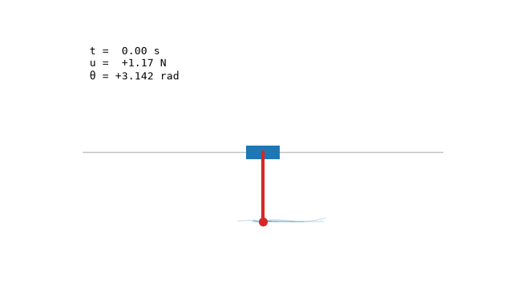

# cuda_mppi_controller

[](https://github.com/shaostassen/CUDA_MPPI_Controller/actions/workflows/ci.yml)

GPU-accelerated Model Predictive Path Integral (MPPI) controller written in CUDA, targeting the Jetson Orin Nano. See [PLAN.md](PLAN.md) for the full backlog.



Cartpole swing-up under the CPU reference controller (K = 512 sampled futures per
control step, T = 50). The faint arcs are a subsample of those futures, replayed
exactly as the controller evaluated them — see [docs/visualization.md](docs/visualization.md).

**Status:** Phase A (CPU reference) complete — dynamics, counter-based RNG, MPPI
core, LQR cross-check, OpenMP path, and visualization. CUDA port (Phase B) next.

## Building

```
cmake --preset cpu      # CPU only, no CUDA toolchain needed
cmake --build --preset cpu
ctest --preset cpu
```

On the Orin, use `--preset release` (adds `ENABLE_CUDA=ON`, `sm_87`) or
`scripts/gpu-test.sh`. macOS needs `brew install libomp` and
`-DOpenMP_ROOT=$(brew --prefix libomp)` for the OpenMP path.

Docs: [environment](docs/env.md) · [OpenMP](docs/openmp.md) ·
[visualization](docs/visualization.md)
